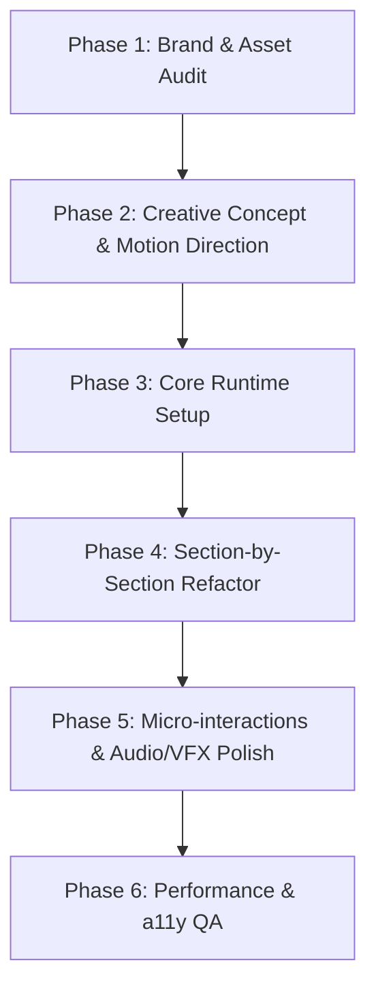

# Creative Experience Transform Skill (Awwwards & FWA Grade)

This skill guides an AI agent to elevate any standard website or web application into an immersive, award-winning, interactive digital experience.

> [!IMPORTANT]
> **Core Golden Rules:**
> 1. **Brand Identity Preservation:** Never force external color schemes or arbitrary dark-mode clones. Always extract, respect, and elevate the target project's existing color palette, brand guidelines, and visual language.
> 2. **Creative Originality:** Do not copy static templates or clone another site verbatim. Invent custom motion metaphors, layout rhythms, and interactions tailored specifically to the project's domain (e.g., luxury, SaaS, fintech, portfolio, e-commerce).
> 3. **Performance & Accessibility First:** Always implement `prefers-reduced-motion` fallbacks, device quality tiers (low-power mobile vs high-performance desktop), and clean cleanup on component unmount to prevent memory leaks.

---

## 1. Transformation Phases & Workflow

Follow this systematic 6-step workflow when applying this skill to a project:



### Phase 1: Brand & Color Audit
Before writing any code:
1. Inspect CSS variables, Tailwind configuration, or design tokens to extract the **primary, secondary, accent, surface, and background colors**.
2. Identify the target audience, tone of voice, and brand archetype (e.g., editorial elegance, high-tech futurism, warm organic minimalism, playful vibrant).
3. Choose typography pairings that complement the brand:
   - *Display/Headline:* High-character serif, geometric sans, or expressive grotesque.
   - *Body:* Ultra-readable humanist sans or neo-grotesque.
   - *Accent/Meta:* Monospace or condensed uppercase for labels, tags, and coordinates.

### Phase 2: Creative Concept & Motion Metaphor
Define the creative direction tailored to this specific domain:
* **Storytelling Rhythm:** How does the page unfold as the user scrolls?
* **Motion Signature:** Are movements snappy and springy (Elastic), fluid and smooth (Power3/Power4), or mechanical and precise (Linear/Stepped)?
* **Hero Hook:** What is the primary interactive element on load (e.g., 3D interactive object, fluid gradient canvas, kinetic typography explosion, magnetic portal)?
* **Section Transitions:** Stripe wipes, camera pans, depth layering (parallax z-index), or morphing shapes.

### Phase 3: Core Runtime & Infrastructure Setup
Install and configure the necessary motion dependencies:
```bash
# Core recommended stack
pnpm add gsap @gsap/react lenis
# Optional depending on creative scope:
# pnpm add three @types/three # (for 3D / WebGL)
# pnpm add howler # (for sound design)
```

Set up the foundational runtime managers (use templates from `./templates/`):
1. **Lenis Smooth Scroll:** Global smooth scroll manager synchronized with GSAP `ticker` and `ScrollTrigger.update()`.
2. **GSAP Registry:** Client-safe registration of `ScrollTrigger`, `Flip`, `SplitText` (or custom DOM splitter).
3. **Quality & Device Manager:** Automatically detect mobile / low-power devices to reduce particle counts or disable heavy blur/canvas shaders.

### Phase 4: Section-by-Section Refactor
Refactor each page section into a motion-driven experience:
* **Hero Section:**
  * Kinetic entrance animation (staggered title reveal, badge floats).
  * Interactive background or ambient canvas reacting to cursor/scroll.
  * Magnetic CTA buttons.
* **Content & Feature Sections:**
  * Pinning & scrubbed horizontal / vertical multi-layer reveals.
  * Parallax image/card depth effects (`yPercent: -20` to `20`).
  * Text line reveals (blur + translateY stagger).
* **Metrics / Stats / Key Facts:**
  * Numeric counters with smooth easing.
  * Interactive hover focus (blurring siblings on hover).
* **Footer / Outro:**
  * Parallax curtain reveal (sticky underlay footer).
  * Immersive call-to-action with interactive particle or audio wave effect.

### Phase 5: Micro-interactions & Polish
* **Custom Magnetic Cursor:** Follower with hover states for clickable elements (`data-cursor="pointer|view|play"`).
* **Sound FX (Optional/Subtle):** Micro-audio cues (clicks, whooshes, ambient pad) with an explicit Mute/Unmute toggle.
* **Page Transitions:** Smooth curtain/fade transition between routes using App Router transition hooks.

### Phase 6: Performance & Accessibility Verification
* Verify `prefers-reduced-motion`: When enabled, bypass scrub animations and display content cleanly.
* Ensure all GSAP contexts (`gsap.context()` or `useGSAP()`) clean up on unmount.
* Test 60fps frame rate during scroll on mobile and desktop.

---

## 2. Creative Motion Patterns Reference

### Pattern A: Kinetic Text Split Reveal
```tsx
"use client";
import { useRef } from "react";
import { useGSAP } from "@gsap/react";
import gsap from "gsap";
import { ScrollTrigger } from "gsap/ScrollTrigger";

gsap.registerPlugin(ScrollTrigger);

export function KineticTitle({ text }: { text: string }) {
  const containerRef = useRef<HTMLHeadingElement>(null);

  useGSAP(() => {
    const words = containerRef.current?.querySelectorAll(".word-wrap");
    if (!words || words.length === 0) return;

    gsap.fromTo(
      words,
      { y: "110%", opacity: 0, filter: "blur(8px)" },
      {
        y: "0%",
        opacity: 1,
        filter: "blur(0px)",
        duration: 1.2,
        ease: "power4.out",
        stagger: 0.08,
        scrollTrigger: {
          trigger: containerRef.current,
          start: "top 80%",
        },
      }
    );
  }, { scope: containerRef });

  return (
    <h2 ref={containerRef} className="overflow-hidden leading-none">
      {text.split(" ").map((word, i) => (
        <span key={i} className="inline-block overflow-hidden mr-[0.25em]">
          <span className="word-wrap inline-block">{word}</span>
        </span>
      ))}
    </h2>
  );
}
```

### Pattern B: Magnetic Interaction Element
```tsx
"use client";
import { useRef } from "react";
import { useGSAP } from "@gsap/react";
import gsap from "gsap";

export function MagneticButton({ children, className = "" }: { children: React.ReactNode; className?: string }) {
  const buttonRef = useRef<HTMLDivElement>(null);

  useGSAP(() => {
    const el = buttonRef.current;
    if (!el) return;

    const xTo = gsap.quickTo(el, "x", { duration: 0.8, ease: "elastic.out(1, 0.3)" });
    const yTo = gsap.quickTo(el, "y", { duration: 0.8, ease: "elastic.out(1, 0.3)" });

    const handleMouseMove = (e: MouseEvent) => {
      const { clientX, clientY } = e;
      const { left, top, width, height } = el.getBoundingClientRect();
      const x = clientX - (left + width / 2);
      const y = clientY - (top + height / 2);
      xTo(x * 0.35);
      yTo(y * 0.35);
    };

    const handleMouseLeave = () => {
      xTo(0);
      yTo(0);
    };

    el.addEventListener("mousemove", handleMouseMove);
    el.addEventListener("mouseleave", handleMouseLeave);

    return () => {
      el.removeEventListener("mousemove", handleMouseMove);
      el.removeEventListener("mouseleave", handleMouseLeave);
    };
  }, { scope: buttonRef });

  return (
    <div ref={buttonRef} className={`inline-block cursor-pointer ${className}`}>
      {children}
    </div>
  );
}
```

---

## 3. Checklist for Complete Project Transformation

- [ ] Extracted and preserved the project's native color system & typography.
- [ ] Initialized Lenis smooth scroll synced with GSAP.
- [ ] Refactored Hero with entrance stagger and ambient visual focal point.
- [ ] Implemented pinned storytelling and parallax layers on key sections.
- [ ] Added interactive micro-behaviors (magnetic buttons, hover distortion).
- [ ] Added seamless routing page transitions.
- [ ] Added `prefers-reduced-motion` accessibility checks.
- [ ] Verified responsive layout and 60fps performance on mobile.
